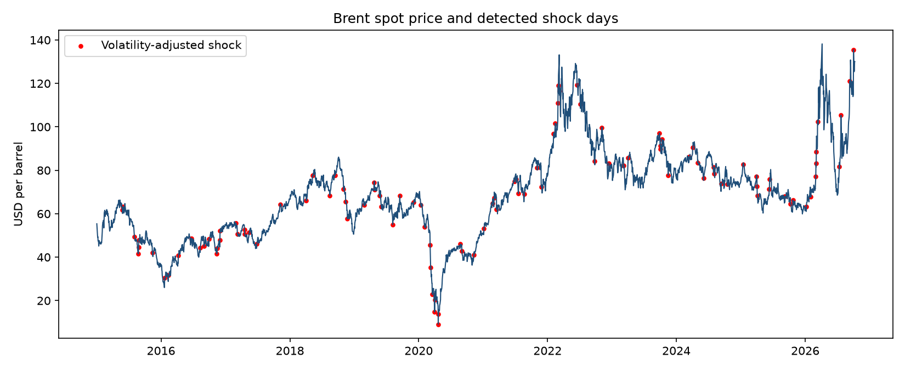
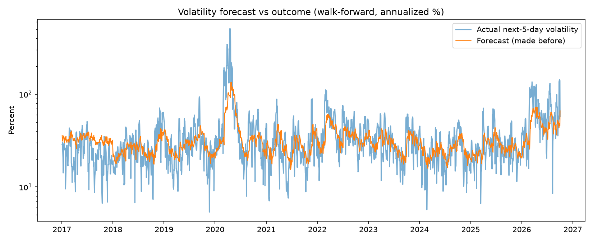

# RisqIQ: Brent crude risk, shocks and next-week volatility

RisqIQ studies daily Brent crude spot prices (2 Jan 2015 to 9 Oct 2026) to answer three practical questions for anyone exposed to fuel costs (airlines, shipping, logistics, supply chain teams):

1. **When does the oil market have a shock?** (detection)
2. **Can shocks be seen coming?** (prediction)
3. **How big could next week's move be?** (volatility forecast and risk band)

The project is deliberately honest about what works and what doesn't. Short version: shocks are hard to time, but next-week volatility can be forecast better than a simple benchmark, and the market's own fear index (OVX) improves that forecast.



## Key findings

| # | Finding | Evidence |
|---|---|---|
| 1 | Shocks cluster in crises | 169 of 2,991 daily returns (5.65%) moved 5% or more. They are concentrated in 2020 (COVID and the price war), 2022 (Ukraine) and 2026 (Iran war and Hormuz disruption). A volatility-adjusted rule flags 106 shock days (about 3.6%). |
| 2 | **Surprise shocks are hard to time** | Predicting "a shock in the next 5 days": a random forest on price and news features scored PR-AUC 0.266 on 2025-2026 (random guessing: 0.178). Flagging the 20% riskiest days, 28% were followed by a shock (vs 18% on all days) and 32% of all shocks were caught. A simple "volatility is high" rule scored below random on this target. |
| 3 | **Next-week volatility is forecastable** | A simple HAR model (yesterday's move, last week's and last month's volatility) beat the benchmark "next week = last month" in 8 of 10 test years (2017-2026), with about 8% lower error overall. It failed in 2017 and 2026. |
| 4 | **OVX helps, news (GPR) does not, for volatility** | On the window where OVX exists (test years 2023-2026), adding OVX beat plain HAR in all 4 years (pooled improvement over benchmark: 19%, versus about 0% for HAR on the same window). Adding the news-based GPR index gave no consistent gain. |
| 5 | Risk bands are roughly calibrated overall, but missed the 2026 rally | Over 2017-2026 the history-only band was broken 4.4% (upside) and 5.3% (downside) of the time, against a 5% target and 5.9% / 6.3% for a static band. In 2026 the upside was broken 15.7% of the time by both, because a volatility model cannot know direction. |

### Latest risk band (data to 9 Oct 2026)

Band for the price change over the next 5 trading days, with a 5% chance of breaking each side (a 90% central range):

| Model | Expected daily move | Band |
|---|---|---|
| Volatility model, price history only (best calibrated over 2017-2026) | 3.65% (58% annualized) | -15.9% to +15.8% |
| Volatility model with OVX (best forecast accuracy, short training window) | 2.79% (44% annualized) | -11.3% to +12.2% |
| Static band (past 250 days of 5-day moves) | n/a | -12.3% to +16.8% |

Because every version under-covered the 2026 upside, the wider upper figure is the safer number for planning. This is a statistical range from past data, not a forecast of direction and not trading advice.



## Data

| Source | What | Notes |
|---|---|---|
| U.S. EIA open data (series RBRTE) | Daily Europe Brent **spot** price, 2015-01-02 to 2026-10-09 (2,992 rows) | A physical spot price, not futures. It can differ from futures quotes when physical supply is tight. |
| Geopolitical Risk (GPR) index, Caldara and Iacoviello | Daily news-based geopolitical risk index | Built from newspaper coverage. Complete daily series, used with trailing averages only. |
| FRED series OVXCLS | CBOE crude oil volatility index | Only available from 2021-10-22, so it is tested on its own shorter window. It is based on options on a WTI oil fund, not Brent. |

## Method in brief

- **Returns and volatility:** daily percentage returns; 20-day rolling volatility annualized by sqrt(252).
- **Shock definitions:** (a) absolute return of 5% or more; (b) absolute return at least 2.5 times the previous 20 days' typical move (the previous-20-day window excludes the day itself).
- **Shock prediction:** features known at the end of day *t* (recent returns, volatility ratios, shock counts, GPR levels and trends) predict whether a shock occurs on days *t+1* to *t+5*. Models: a volatility rule, logistic regression, random forest. Split by time (train 2015-2024, test 2025 onward). Metric: PR-AUC, precision, recall.
- **Volatility forecast:** HAR regression in logs, retrained every year (walk-forward, 10-day gap between training and test to avoid leakage). Scored against the benchmark "next 5-day volatility = last 22-day volatility".
- **Risk band:** the volatility forecast is scaled by the historical distribution of past forecast errors; the result is checked by counting how often the next 5 days broke the band.

## Event context (sourced only)

Large-move clusters can be matched with documented events. Only events with a source link are listed; other clusters are intentionally left unlabelled.

| Dates | Event | Source |
|---|---|---|
| 2016-11-30 | OPEC agrees a production cut in Vienna | https://www.opec.org/pr-detail/458-30-nov-2016.html |
| 2020-03-06 to 03-09 | OPEC+ talks collapse and Saudi-Russia price war | https://www.spglobal.com/en/research-insights/articles/oil-prices-plunge-in-response-to-the-collapse-of-the-opec-alliance |
| 2022-03-01 to 03-02 | Russia's invasion of Ukraine pushes prices above $100 | https://www.eia.gov/TODAYinENERGY/detail.php?id=51498 |
| 2026-03 | Iran war and Hormuz disruption | https://www.eia.gov/Todayinenergy/detail.php?id=67424 |

## SQL analysis (PostgreSQL)

Create an empty PostgreSQL database (`CREATE DATABASE risqiq;`). Copy `brent_market_features.csv`, `test_predictions.csv` and `volatility_forecasts.csv` into a folder PostgreSQL can read (for example `C:\Users\Public\risqiq\`), then run `sql/setup.sql` with your query window connected to `risqiq`. It creates the tables, loads the CSV files and adds the sourced events. `sql/queries_postgres.sql` then answers five questions: yearly risk summaries, the most volatile months, what happened inside each sourced event window (join), whether higher model risk scores are followed by more shocks (window function), and how the volatility forecast performed by year.

### What the SQL queries show

The yearly totals add up exactly to the Python results (2,992 trading days, 169 moves of 5% or more, 106 volatility-adjusted shocks), and the top-10 months match `analyze_large_movements.py`.

- **Calm years and crisis years look very different.** Average volatility was 74% in 2020 and 63% in 2026, against 26% to 45% in every other year. 2020 had 41 moves of 5% or more (worst day -47%, a physical spot price move) and 2026 had 39 up to early October. Four of the ten months with the most large moves are in 2026.
- **A fixed 5% rule behaves badly across regimes.** In calm 2017 it flags no days while the volatility-adjusted rule flags 7. In 2020 and 2026 it flags 41 and 39 days while the adjusted rule flags 12 and 10, because 5% is normal in a crisis. This is why the adjusted definition is used for prediction.
- **Sourced event windows.** The three short windows (2016, 2020, 2022) contain only large-move days, but they were taken from detected clusters, so that is partly by construction. March 2026 had 11 large moves in 22 trading days, with a biggest move of 12.5%.
- **Risk score groups (2025 onward).** The top fifth of days by score was followed by a shock 28.4% of the time, against 17.8% on all days. The groups below it were 23.6%, 15.7% and 4.5%, but the lowest-score group was 16.9%, so a low score is not a reliable all-clear.
- **Volatility forecast by year.** In normal years the average forecast is within about 2 points of actual volatility. In stress years it is too low: 44.5% vs 69.0% in 2020, 36.8% vs 43.7% in 2022 and 46.7% vs 64.5% in 2026, with forecasts below the outcome on 60% to 69% of days. In 2017 it was too high (32.7% vs 24.3%). The model is slow to adjust when volatility changes regime.

## Limitations

- **Small samples.** The 2025-2026 test period has 444 days and overlapping 5-day windows, so there are few independent episodes. Differences smaller than about 0.05 in PR-AUC should be treated as noise.
- **Test data was looked at more than once.** Features and targets were adjusted after seeing validation and test results. The shock-prediction numbers are indicative, not a clean out-of-sample claim.
- **The surprise-shock score is not a danger level.** It estimates the chance of a move that is unusually large for the current regime, so it can read low in a very volatile market. Use the volatility forecast and risk band for the level of risk.
- **Volatility models cannot predict direction.** The 2026 upside was broken far more often than 5%.
- **OVX results rest on four test years** with small training sets, and 2026 is a partial year.
- **Single asset, spot prices only,** and results depend on the 2020 and 2026 crises.

## How to run

```
pip install pandas numpy scikit-learn matplotlib requests xlrd openpyxl
```

Add your free EIA API key to `api_key` in `src/fetch_market_data.py` (do not publish it). Download the GPR daily file and the OVX CSV into `data/raw/`, then run from the project root, in this order:

1. `src/fetch_market_data.py`
2. `src/prepare_market_data.py`
3. `src/analyze_large_movements.py` (plus `src/verify_price_movements.py` and `src/validate_market_data.py` for data checks)
4. `src/build_model.py`
5. `src/merge_ex_data.py`
6. `src/train_model.py`, `src/compare_ex_data.py`, `src/charts.py`
7. `src/forecast_volatility.py`
8. `sql/setup.sql`, then `sql/queries_postgres.sql` (PostgreSQL, run in your SQL client, see below)

## Project structure

```
data/raw         EIA prices, GPR daily file, OVX CSV
data/processed   market features and model datasets
outputs          charts and prediction files
sql              setup.sql (creates and loads the tables), queries_postgres.sql (5 analysis queries)
src              all scripts
```
